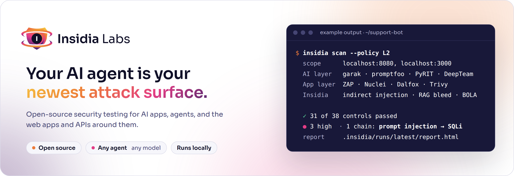

<p align="center">
  <picture>
    <source media="(prefers-color-scheme: dark)" srcset="brand/readme/hero-dark.png">
    
  </picture>
</p>

<p align="center">
  <a href="LICENSE"></a>
  
  
  <a href="https://insidialabs.com"></a>
  <a href="https://insidialabs.com/docs/"></a>
</p>

<p align="center">
  <a href="https://insidialabs.com"><b>Website</b></a> ·
  <a href="#use-with-your-coding-agent"><b>Agent skill</b></a> ·
  <a href="#install"><b>Install CLI</b></a> ·
  <a href="#quickstart"><b>Quickstart</b></a> ·
  <a href="https://insidialabs.com/docs/"><b>Docs</b></a>
</p>

<br>

## Security testing for the AI app you're building

Insidia helps you check your AI app, agent, web app, or API for security issues before you ship. Run a scan on your machine, open the report, and review the evidence and suggested fixes. After a change, rerun the checks to see what improved.

**Free and open source. No account required.** Use the CLI yourself, ask your coding agent to run it with the Insidia skill, or add scans to CI.

- **Test your app's boundaries.** Check for prompt injection, exposed data, and application vulnerabilities. Available checks depend on your target and installed engines.
- **Know what was checked.** Reports show findings, skipped checks, and coverage, with the engine behind each finding.
- **Keep control of the scan.** Choose the hosts Insidia may test. Start on localhost and use your own model endpoint when needed.

Some checks currently work only on the project's test apps, and external engine integrations are experimental. Use the report's coverage table to see what ran against your app. [See current coverage](https://insidialabs.com/docs/concepts/what-it-tests/).

## Use with your coding agent

Install the **Insidia skill** to give your coding agent the steps for setting up a scan, reviewing findings, and opening your report. Run this from the project you want to test, then select your agent when prompted:

```bash
npx skills add Rushi-Balapure/Insidia-Labs
```

The skill installer needs Node.js 22 or newer. Scans need Python 3.12 or newer and the Insidia CLI; the skill guides your agent through installing it with `uv` or `pipx`.

In Claude Code, Cursor, Codex, or another agent that supports skills and shell commands, tell it where your app is running:

```text
Use the Insidia skill to test my app at http://127.0.0.1:8080/chat.
Only scan localhost. Review the findings and open the report when you're done.
```

Replace the example URL with your running app's address. Your agent confirms the hosts, configures the target, runs the scan, and opens the HTML report. You can then ask it to help address a finding and repeat the scan.

[Agent setup guide](https://insidialabs.com/docs/start/agent/) · [Read the skill](skills/insidia/SKILL.md)

## Install

Prefer the terminal? Install the CLI with Python 3.12 or newer and either `uv` or `pipx`:

```bash
# uv (recommended)
uv tool install "git+https://github.com/Rushi-Balapure/Insidia-Labs@v1.0.0#subdirectory=core"

# pipx
pipx install "git+https://github.com/Rushi-Balapure/Insidia-Labs@v1.0.0#subdirectory=core"
```

The current release is **v1.0.0**. Install from GitHub using the commands above; Insidia is not published on PyPI yet. [Full installation guide](https://insidialabs.com/docs/start/install/).

Check your version and update to the latest release without reinstalling by hand:

```bash
insidia --version
insidia upgrade --check   # only report whether a newer release exists
insidia upgrade           # install the latest release
```

Release notes are in [CHANGELOG.md](CHANGELOG.md) and on the [releases page](https://github.com/Rushi-Balapure/Insidia-Labs/releases).

## Quickstart

Start your app, then run these commands from its project directory. This example uses a chat endpoint at `http://127.0.0.1:8080/chat`; replace it with your app's URL:

```bash
insidia init --url http://127.0.0.1:8080/chat
insidia doctor
insidia scan --policy L1
insidia report --open
```

`init` writes `insidia.yaml`, where you configure the target, request format, and allowed hosts. For a web app, use `--kind web` with your URL. If the file already exists, edit it rather than running init again. `doctor` checks your setup; your app must already be running when you scan.

The report opens in your browser and shows findings, evidence, remediation guidance, and checks that could not run. Each scan also saves files under `.insidia/runs/<run-id>/`:

| Output | Use it for |
| --- | --- |
| `report.html` | Reviewing the scan in your browser |
| `findings.json` | Reading findings in scripts or with a coding agent |
| `results.sarif` | Showing findings in CI code scanning |
| `benchmark.json` | Checking the policy result, control results, and skips |

To repeat a scan after fixing your app:

```bash
insidia rerun
insidia report --open
```

[Follow the quickstart](https://insidialabs.com/docs/start/quickstart/) · [Learn to read a report](https://insidialabs.com/docs/concepts/report/)

## What can I test?

Insidia brings AI and application security checks into one scan. The areas below describe its intended coverage; support varies by target and engine. Check [what it tests](https://insidialabs.com/docs/concepts/what-it-tests/) for current availability.

| AI apps and agents | Web apps, APIs, and repositories |
| --- | --- |
| Prompt injection and jailbreaks | Injection, path traversal, and SSRF |
| System prompt and secret leakage | Access control and authentication issues |
| Tool misuse and excessive agency | Secrets in code and Git history |
| RAG and memory poisoning | Vulnerable dependencies and container images |
| MCP and skill supply chain | Attack paths between the AI and application layers |

Start with **L1**, the baseline policy that needs no model. L2 and L3 are not available yet. Checks that need a model are skipped when none is configured. A skipped check is not a pass, and a scan with no findings does not establish that your app is secure.

Use `insidia engines list` to see available engines. To add engines, name them explicitly, for example `insidia engines install garak zap`. Some engines have additional requirements; see the [engine guide](https://insidialabs.com/docs/concepts/engines/).

## Configure your scan

`insidia.yaml` holds your app's target and scope. Localhost is the default. Test only systems you own or have permission to test; every non-local host needs `authorized: true` in the scope and `--yes` when scanning.

Keep credentials in environment variables and reference them with `secret_ref: env:APP_TOKEN`. Findings mask detected secrets, for example `[AWS_ACCESS_KEY len=20 fp=3f9a1c07]`.

[Configuration reference](https://insidialabs.com/docs/start/config/) · [Scope and permissions](https://insidialabs.com/docs/start/scope/) · [Run in CI](https://insidialabs.com/docs/guides/ci/)

For automation, add `--json` and use the exit code:

| Exit code | Meaning |
| --- | --- |
| `0` | The run finished and the policy passed. |
| `1` | A check found a problem, so the policy failed. This holds even if another check did not finish. |
| `2` | The run was incomplete with no finding, or an error stopped it. |
| `130` | The run was cancelled. |

[Full CLI reference](https://insidialabs.com/docs/reference/cli/) · [Troubleshooting](https://insidialabs.com/docs/guides/troubleshooting/)

## Credits

Each project keeps its own license. The full notices are in [THIRD_PARTY_NOTICES.md](THIRD_PARTY_NOTICES.md).

| AI and agent layer | Application layer |
| --- | --- |
| [garak](https://github.com/NVIDIA/garak) · Apache-2.0 | [ZAP](https://github.com/zaproxy/zaproxy) · Apache-2.0 |
| [promptfoo](https://github.com/promptfoo/promptfoo) · MIT | [Nuclei](https://github.com/projectdiscovery/nuclei) · MIT |
| [PyRIT](https://github.com/Azure/PyRIT) · MIT | [Dalfox](https://github.com/hahwul/dalfox) · MIT |
| [DeepTeam](https://github.com/confident-ai/deepteam) · Apache-2.0 | [Trivy](https://github.com/aquasecurity/trivy) · Apache-2.0 |
| [mcp-scanner](https://github.com/cisco-ai-defense/mcp-scanner) · Apache-2.0 | [osv-scanner](https://github.com/google/osv-scanner) · Apache-2.0 |
| [SkillSpector](https://github.com/NVIDIA/SkillSpector) · Apache-2.0 | [gitleaks](https://github.com/gitleaks/gitleaks) · MIT |
| [NuGuard](https://github.com/NuGuardAI/nuguard) · Apache-2.0 | [Bandit](https://github.com/PyCQA/bandit) · Apache-2.0 |
| | [gosec](https://github.com/securego/gosec) · Apache-2.0 |

Also [katana](https://github.com/projectdiscovery/katana) and [httpx](https://github.com/projectdiscovery/httpx), both MIT.

## License

[Apache-2.0](LICENSE). The Sora font in `brand/fonts/` is under the SIL Open Font License. The Insidia Labs name and logo are trademarks and are not part of the Apache license. See [NOTICE](NOTICE).

Contributing and disclosure: [CONTRIBUTING.md](CONTRIBUTING.md), [SECURITY.md](SECURITY.md).

<br>

<p align="center">
  <br>
  <sub><a href="mailto:insidialabs@gmail.com">insidialabs@gmail.com</a> · <a href="https://insidialabs.com">insidialabs.com</a></sub>
</p>
